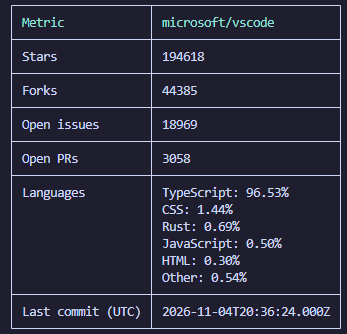

# GitMetrics

[](https://www.npmjs.com/package/@urlastkizz/gitmetrics)
[](https://github.com/urlastkizz/GitMetrics/actions/workflows/ci.yml?query=branch%3Amain)
[](LICENSE)

GitMetrics is a TypeScript CLI for exploring GitHub from your terminal: `profile` shows a user's public profile and five newest repositories, `repo` summarizes a public repository, `prs` measures pull request merges, and `activity` measures recent user contributions. The profile lookup is the default command, invoked as `gitmetrics <username>`; there is no literal `profile` subcommand.

Built to practice TypeScript, API integration, pure metric calculations, automated testing, and collaboration through Git branches and pull requests.

[Authentication](#authentication): only `activity` requires a GitHub token; profile, `repo`, and `prs` queries can run anonymously.

[Quick start](#quick-start) · [Installation](#installation) · [Usage](#usage) · [Authentication](#authentication) · [Development](#development)

## Quick start

Run a public repository query without cloning, building, or installing globally:

```sh
npx @urlastkizz/gitmetrics repo microsoft/vscode
```

[Preview the terminal screenshot](#repository-metrics).

Expected output, captured from the published **0.1.1** package on **2026-11-03** (terminal colors omitted):

```text
┌───────────────────┬──────────────────────────┐
│ Metric            │ microsoft/vscode         │
├───────────────────┼──────────────────────────┤
│ Stars             │ 194526                   │
├───────────────────┼──────────────────────────┤
│ Forks             │ 44393                    │
├───────────────────┼──────────────────────────┤
│ Open issues       │ 18978                    │
├───────────────────┼──────────────────────────┤
│ Open PRs          │ 3090                     │
├───────────────────┼──────────────────────────┤
│ Languages         │ TypeScript: 96.48%       │
│                   │ CSS: 1.44%               │
│                   │ Rust: 0.70%              │
│                   │ JavaScript: 0.51%        │
│                   │ HTML: 0.31%              │
│                   │ Other: 0.56%             │
├───────────────────┼──────────────────────────┤
│ Last commit (UTC) │ 2026-11-03T08:45:50.000Z │
└───────────────────┴──────────────────────────┘
```

Profile, repository, and activity examples below were also captured from the published **0.1.1** package against public GitHub data on that date. Pull request examples are illustrative and use the source build. Counts and activity dates change when you run the commands again. Repository queries paginate GitHub results, so large repositories can take longer; anonymous requests may reach GitHub's rate limit. See [Authentication](#authentication) to use a token.

## Requirements

- **Node.js >=22.13.0**, matching `package.json`, and npm.
- Internet access to install the package and query GitHub.
- A GitHub token for `activity`. Profile, `repo`, and `prs` queries can run without one.

## Installation

Use `npx` to run the published package without installing globally:

```sh
npx @urlastkizz/gitmetrics repo octocat/Hello-World --json
```

Or install the CLI globally:

```sh
npm install -g @urlastkizz/gitmetrics
gitmetrics repo octocat/Hello-World
```

### Run from source

For local development, Git is also required. Clone the project, install its
locked dependencies, build, and query a public repository:

```sh
git clone https://github.com/urlastkizz/GitMetrics.git
cd GitMetrics
npm ci
npm run build
node dist/index.js repo octocat/Hello-World --json
```

## Authentication

The default **profile** lookup (`gitmetrics <username>`), **repo**, and **prs** can run anonymously. Set `GITHUB_TOKEN` to authenticate them for a higher REST API rate limit. **activity** requires a token because it uses GitHub's GraphQL API. For `repo`, `prs`, and `activity`, `--token <token>` overrides `GITHUB_TOKEN`; profile reads the environment variable only.

### Create a token

Create a fine-grained personal access token using [GitHub's token instructions](https://docs.github.com/en/authentication/keeping-your-account-and-data-secure/managing-your-personal-access-tokens#creating-a-fine-grained-personal-access-token):

1. Open GitHub **Settings → Developer settings → Personal access tokens → Fine-grained tokens → Generate new token**.
2. Name it (for example, `GitMetrics`), choose a short expiration, and select your account as the resource owner.
3. Under **Repository access**, choose **Public repositories** (read-only). Fine-grained tokens already include read-only access to public repositories; do not grant private repository access or additional write/account permissions for these public queries.
4. Generate the token and copy it into your shell configuration below. Replace `YOUR_TOKEN` with its value. Renew or replace it after expiration.

### Configure your shell

**PowerShell — current session:**

```powershell
$env:GITHUB_TOKEN = 'YOUR_TOKEN'
```

**PowerShell on Windows — permanent, for your user:**

```powershell
[Environment]::SetEnvironmentVariable('GITHUB_TOKEN', 'YOUR_TOKEN', 'User')
```

**cmd — current session:**

```bat
set "GITHUB_TOKEN=YOUR_TOKEN"
```

**cmd — permanent, for your Windows user:**

```bat
setx GITHUB_TOKEN "YOUR_TOKEN"
```

The Windows permanent settings apply to future terminals; they do not update the current session. Close and reopen your terminal application, or also run its current-session command. See [PowerShell environment variables](https://learn.microsoft.com/en-us/powershell/module/microsoft.powershell.core/about/about_environment_variables) and [setx](https://learn.microsoft.com/en-us/windows-server/administration/windows-commands/setx).

**bash/zsh — current session:**

```sh
export GITHUB_TOKEN='YOUR_TOKEN'
```

**bash — permanent for interactive shells:**

```bash
printf '\n%s\n' "export GITHUB_TOKEN='YOUR_TOKEN'" >> ~/.bashrc
source ~/.bashrc
```

**zsh — permanent for interactive shells:**

```zsh
printf '\n%s\n' "export GITHUB_TOKEN='YOUR_TOKEN'" >> "${ZDOTDIR:-$HOME}/.zshrc"
source "${ZDOTDIR:-$HOME}/.zshrc"
```

Run the permanent setup once; edit the existing entry when replacing a token. Bash login shells read the first available `~/.bash_profile`, `~/.bash_login`, or `~/.profile` instead of `~/.bashrc`. Ensure that login file sources `~/.bashrc`, or put the export in that login file. PowerShell on macOS/Linux can put its session assignment in `$PROFILE` instead of using Windows user environment settings. See the [Bash startup rules](https://www.gnu.org/software/bash/manual/html_node/Bash-Startup-Files.html) and [zsh startup rules](https://github.com/zsh-users/zsh/blob/master/Doc/Zsh/files.yo).

### Keep tokens private

Never commit tokens, including in scripts, shell startup files, or screenshots. `--token` can expose the value in shell history and process arguments; prefer an environment variable. The setup commands above can also enter shell history, and permanent configuration stores the value in your Windows user environment or shell startup file. Keep that configuration private. GitMetrics itself does not store tokens or load `.env` files.

A missing activity token produces setup commands and a link to this section before any request. A rejected token (HTTP 401) produces a different message: `GitHub rejected the token. It may be invalid or expired.` Both failures exit with `1` without printing the token.

## Usage

After installing globally, use `gitmetrics` as shown below. Without a global install, replace `gitmetrics` with `npx @urlastkizz/gitmetrics`. For a local build, use `node dist/index.js`. To run the TypeScript source, use `npm start --`; for example, `npm start -- repo octocat/Hello-World --json` forwards the arguments after `--` to the CLI. The npm package is named `@urlastkizz/gitmetrics`; the executable is named `gitmetrics`.

### Profile (default command)

Show a public profile and up to five repositories, ordered by creation date from newest to oldest:

```sh
gitmetrics <username> [--json]
gitmetrics octocat
gitmetrics octocat --json
```

Pass a username without `@` or a profile URL. Options:

| Flag            | Purpose                                                                                          |
| --------------- | ------------------------------------------------------------------------------------------------ |
| `--json`        | Print one JSON object containing `profile` and `repositories`, using GitHub API response fields. |
| `-h, --help`    | Show CLI help.                                                                                   |
| `-V, --version` | Show the installed version.                                                                      |

Actual output excerpt from `gitmetrics octocat` (the repository table follows the card):

```text
┌──────────────────────────────────────────────────────────────────────────────────────────────────┐
│ GITHUB PROFILE · @octocat                                                                        │
├────────────────────────┬─────────────────────────────────────────────────────────────────────────┤
│ Name                   │ The Octocat                                                             │
├────────────────────────┼─────────────────────────────────────────────────────────────────────────┤
│ Bio                    │ Not provided                                                            │
├────────────────────────┼─────────────────────────────────────────────────────────────────────────┤
│ Followers              │ 24,910                                                                  │
├────────────────────────┼─────────────────────────────────────────────────────────────────────────┤
│ Public repositories    │ 8                                                                       │
└────────────────────────┴─────────────────────────────────────────────────────────────────────────┘
```

The repository table includes name, primary language, stars, forks, and link. Terminal output supports colors and adapts column widths. Profile queries use `GITHUB_TOKEN` when configured, otherwise they run anonymously.

### Repository metrics

```sh
gitmetrics repo <owner/name> [--languages <n>] [--json] [--no-color] [--token <token>]
gitmetrics repo octocat/Hello-World
gitmetrics repo octocat/Hello-World --json
gitmetrics repo microsoft/TypeScript --languages 1 --no-color
```

Terminal output from `gitmetrics repo microsoft/vscode`:



The screenshot and Quick start text example show the same fields from different snapshots; counts and dates can change between queries.

| Flag              | Purpose                                              |
| ----------------- | ---------------------------------------------------- |
| `--json`          | Print repository metrics as one JSON object.         |
| `--languages <n>` | Show the top 1–20 table languages; default: `5`.     |
| `--no-color`      | Disable colors in the default table output.          |
| `--token <token>` | Override `GITHUB_TOKEN`; authentication is optional. |
| `-h, --help`      | Show command help.                                   |

Actual output from `gitmetrics repo octocat/Hello-World --json`:

```json
{
  "repository": "octocat/Hello-World",
  "stars": 3897,
  "forks": 7358,
  "openIssues": 6151,
  "openPullRequests": 1369,
  "languages": [],
  "lastCommitAt": "2012-03-06T23:06:50.000Z"
}
```

The default table shows the same metrics. Open issues exclude pull requests; all open PR pages are counted. Languages are sorted by descending bytes, then name. The table shows the top five languages by default and groups the rest into a final `Other` row. Use `--languages <n>` to select an integer from 1 through 20; invalid values exit with code `2`. No `Other` row appears when all languages fit within the limit.

Table percentages are shown to two decimals and balanced to total exactly 100% for nonempty results. The rounding difference is applied to the largest displayed row, including `Other`, with ties resolved by existing order. JSON always keeps every language, regardless of `--languages`, with the original independently rounded percentages (bytes divided by total bytes); its sum can differ slightly from 100. An empty language list appears as `[]` in JSON or `No languages` in the table.

The last commit date comes from the default branch's latest commit, normalized to UTC. An empty repository uses `lastCommitAt: null` or `No commits`. Private repositories and caching are outside this command's scope.

### Pull request merge metrics

```sh
gitmetrics prs <owner/name> [--limit <n>] [--json] [--no-color] [--token <token>]
gitmetrics prs microsoft/vscode
gitmetrics prs microsoft/vscode --limit 100 --json
```

The `prs` command is available in the source build; use `node dist/index.js prs ...` after building until a release includes it.

| Flag              | Purpose                                                |
| ----------------- | ------------------------------------------------------ |
| `--limit <n>`     | Analyze 1–100 closed pull requests; default: `50`.     |
| `--json`          | Print one JSON object with times in seconds or `null`. |
| `--no-color`      | Disable colors in the table output.                    |
| `--token <token>` | Override `GITHUB_TOKEN`; authentication is optional.   |
| `-h, --help`      | Show command help.                                     |

Illustrative table output:

```text
┌───────────────────────┬──────────────────┐
│ Metric                │ owner/name       │
├───────────────────────┼──────────────────┤
│ PRs analyzed          │ 4                │
├───────────────────────┼──────────────────┤
│ Merged                │ 3                │
├───────────────────────┼──────────────────┤
│ Closed without merge  │ 1                │
├───────────────────────┼──────────────────┤
│ Merge rate            │ 75.00%           │
├───────────────────────┼──────────────────┤
│ Median time to merge  │ 2d 4h            │
├───────────────────────┼──────────────────┤
│ Average time to merge │ 2d 4h            │
└───────────────────────┴──────────────────┘
```

Corresponding illustrative JSON:

```json
{
  "repository": "owner/name",
  "analyzed": 4,
  "merged": 3,
  "closedWithoutMerge": 1,
  "mergeRate": 75,
  "medianTimeToMergeSeconds": 187200,
  "averageTimeToMergeSeconds": 187200
}
```

“Last N” is approximate: one REST request fetches up to 100 closed PRs ordered by last update, then selects the requested N by closure date within that page. Older PRs updated recently can displace more recently closed PRs. The command does not paginate or guarantee the latest N closures across the whole repository; fewer than N candidates means a smaller sample. Bots are included, and dates are interpreted in UTC.

A PR is merged when `merged_at` is non-null. Merge rate is merged divided by analyzed, multiplied by 100. Time to merge is `merged_at - created_at`; the median and arithmetic mean use only merged PRs. For an even count, the median averages the middle two durations. JSON retains numeric seconds without display rounding; the table truncates to whole seconds and uses days, hours, minutes, and seconds. Percentages display two decimals.

No closed PRs produces `No closed pull requests`, zero counts, a zero merge rate, and null JSON times. A sample with no merges shows `0.00%` and `n/a` times (JSON: `null`). Invalid limits exit with code `2` before token lookup or API access.

### User activity

```sh
gitmetrics activity <user> [--days <n>] [--json] [--no-color] [--token <token>]
gitmetrics activity octocat
gitmetrics activity octocat --days 7 --json
```

Activity requires a GitHub token available through `GITHUB_TOKEN` or the explicit token option. The explicit option takes precedence. Keep credentials out of screenshots, shared output, and committed files.

| Flag              | Purpose                                                         |
| ----------------- | --------------------------------------------------------------- |
| `--days <n>`      | Select 1–365 UTC calendar days, including today; default: `30`. |
| `--json`          | Print activity metrics as one JSON object.                      |
| `--no-color`      | Disable colors in the default table output.                     |
| `--token <token>` | Override `GITHUB_TOKEN`; authentication is required.            |
| `-h, --help`      | Show command help.                                              |

Illustrative source-build output from `gitmetrics activity octocat --days 7 --json`, including the new streak fields:

```json
{
  "user": "octocat",
  "days": 7,
  "startDate": "2026-10-28",
  "endDate": "2026-11-03",
  "totalContributions": 0,
  "activeDays": 0,
  "busiestDay": null,
  "currentStreak": { "days": 0, "truncated": false },
  "longestStreak": { "days": 2, "truncated": true }
}
```

The command uses GitHub's GraphQL contribution calendar. It counts contributions exposed for the queried user and token, rather than repository commits. The period starts at UTC midnight on the first day and ends at the query's captured current instant; today's count is partial.

Active days have at least one contribution. The busiest day has the highest daily count, with ties resolved to the most recent date. A period without contributions returns both totals as `0` and `busiestDay: null` (or `No contributions` in the table).

Streaks count consecutive active UTC days over a fixed **365-day window including today**, independent of `--days`. One GraphQL request supplies both the streak window and the selected period's totals. The current streak includes today when active; if today is inactive, an active yesterday keeps the streak alive. Two inactive days reset it to zero. The longest streak is the longest run within the window; if equal-length runs tie, a truncated run wins because it may have started earlier.

A run touching the first day of the window keeps its observed length and has `truncated: true` in JSON. The table adds `+`, so a two-day boundary run appears as `2+ days`; all 365 days active yields `365+ days`. Runs that do not touch the start have `truncated: false`. No contributions in the window yields zero for both streaks, without truncation. Existing JSON fields retain their meaning; the two new fields each contain `days` and `truncated`.

For the illustrative JSON above, the table shows these additional rows (the two-day run occurred at the start of the 365-day window):

```text
│ Current streak      │ 0 days  │
│ Longest streak      │ 2+ days │
```

Charts, contribution breakdowns, and caching are outside this command's scope.

### Help and errors

```sh
gitmetrics --help
gitmetrics repo --help
gitmetrics activity --help
gitmetrics prs --help
gitmetrics --version
```

Successful queries, help, and version exit with `0`; failed queries exit with `1`; invalid CLI usage exits with `2`. Query errors go to stderr, leaving stdout empty. Requests use a 15-second timeout without automatic retries.

Repository and activity queries report rejected credentials, rate limits, missing resources, and network failures with useful error messages. Rate-limit errors include the UTC reset time when GitHub supplies it. Profile queries report rejected credentials explicitly and otherwise use a general query error message. Activity rejects partial GraphQL responses with errors and reports missing authentication before making a request.

## Development

```sh
npm run typecheck
npm run lint
npm run format:check
npm test
npm run test:coverage
npm run build
```

Tests use mocked GitHub responses and run without network access. GitHub Actions checks Node.js 22, 24, and 26.

### Package checks

After `npm ci`, both commands build the package through `prepack`, even when
`dist/` does not exist:

```sh
npm pack --dry-run
npm publish --dry-run
```

Publishing runs typecheck, lint, and tests in `prepublishOnly`; `prepack` then
builds the distributable once. `npm pack` builds without running publication
checks. Avoid `--ignore-scripts` when preparing a package from a clean checkout.

The executable mapping uses `dist/index.js` without a leading `./`. npm 11.19.1
normalizes that prefix and otherwise prints the misleading warning
`bin[gitmetrics] script name dist/index.js was invalid and removed`, even though
the packed manifest retains `bin`. That warning was caused by path normalization,
not by the missing build directory.

On a clean checkout, npm 11.19.1 can still print `No bin file found at dist/index.js`
before it runs lifecycle scripts. This preliminary warning is accepted: `prepack`
creates the executable before npm collects package contents. Integration tests
check the clean package, its installed manifest, and `gitmetrics --version`.
The publish dry run also checks registry version availability; an already
published version can make it fail even when package preparation succeeds.

```text
src/
  index.ts          # Executable entry point
  cli/              # Commander commands and current profile implementation
  core/             # Pure metric calculations and project types
  github/           # API clients, validation, pagination, and errors
  output/           # Repository and activity table/JSON formatters
  config/           # Token resolution
  utils/            # Reserved for shared helpers
tests/
  integration/      # CLI smoke tests and mocked GitHub queries
  unit/             # Metrics, clients, formatters, configuration, and commands
```

Repository and activity commands separate parsing, metric calculation, API access, and presentation. Profile requests also live in `src/github`; its existing tables remain in `src/cli/profile.ts`.

The stack includes TypeScript in strict mode, Node.js, Commander, Octokit, Zod, picocolors, cli-table3, Vitest, and tsup. See [CONTRIBUTING.md](CONTRIBUTING.md) for the existing contribution workflow.

## License

MIT. See [LICENSE](LICENSE).
